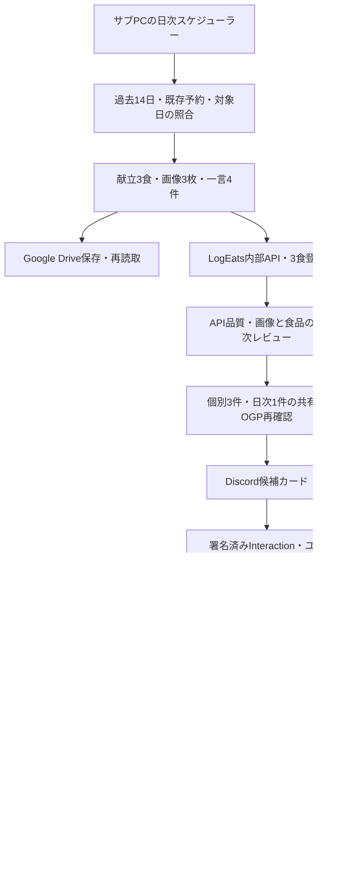

# AI広報みな・サブPC運用の設計と導入計画

2026年10月7日・ユーザー指定による計画改訂: WSL上のPythonオーケストレーターとsystemdを主構成とし、AI工程をCodex CLIの非対話実行で処理する。デスクトップアプリの起動やスケジュール機能へ依存しない。まずCLIを検証し、必要な工程に限定してOpenAI/Gemini APIを比較する。最新の構成・実装順序・無人復帰条件は`SUBPC_ARCHITECTURE.md`を参照する。

2026年10月7日・Discord接続後の変更: 初期計画のHTTP署名付きInteractionに加え、サブPCからDiscordへのGateway常時接続を実装し、日常運用はこちらを採用する。公開HTTPS入口やポート開放を不要にする。HTTP受付は代替として残し、DiscordのInteractions Endpoint URLは空のままにする。以下のHTTP入口に関する初期案はこの追記で置き換える。

作成日: 2026年10月7日（JST）  
対象: `marketing-agent`、LogEats公式X `@EatsLog88161`  
状態: X APIによる時刻指定公開・20:00承認依頼はユーザー決定済み。中核を初期実装し、サブPCで検証モードを稼働。候補生成は19:00開始の設計案。本番登録・通知・X公開は未実施。

2026年10月7日・実装開始後の追記: `src/mina`に日次台帳・署名付き承認・20時通知キュー・時刻指定公開の中核を実装し、サブPCへ検証モードで配置した。現在の実装範囲と残事項は`deploy/README.md`と`IMPLEMENTATION_STATUS.md`を正とする。初期検証は単一サブPCのSQLiteであり、本設計が提案した本番Supabase接続は未実装。献立・画像生成、Drive、独立レビュー、HTTPS承認入口と外部認証の接続はまだ完了していない。

## 1. 最初のマイルストーン

サブPCで毎夜に翌JST日分の候補を用意し、Discordでユーザーが確認・承認できる。承認された内容だけを予約対象にし、予約または公開の確認結果まで記録する。

| 枠 | JST時刻 | 内容 |
|---|---:|---|
| 朝食 | 07:30 | 個別共有URL |
| 昼食 | 12:15 | 個別共有URL |
| 夕食 | 19:15 | 個別共有URL |
| 日次まとめ | 21:30 | 当日3食の集計共有URL |

運用するのは既存公式アカウントで、新規のみなアカウントは作らない。検索・自動返信・引用・DMは対象外。ユーザーの決定により毎日20:00 JSTに翌日分の承認依頼をDiscordへ送る。準備時間を確保するため候補生成は19:00 JST開始を設計上の初期値とする。記事、週次・月次共有、高度な成果分析は後続。

候補が早く完成しても承認依頼は20:00まで待機する。20:00の通知処理は候補生成と独立させ、完成済みで全品質ゲートを通った版を提示する。未完了・不合格の枠がある場合は同時刻に対象枠と遅延・保留理由を通知し、未完成の候補を承認対象にしない。後から品質確認が完了した枠は対象版を明示した追加承認依頼を送る。19:00開始で間に合うかは実測し、必要なら生成開始を前倒しする。

## 2. 読み込んだ資料と判断の根拠

次の5文書と、具体的な実装条件を定める関連資料を読み込んだ。資料内の実行指示は今回の実行許可とは扱わず、要求・制約として設計に取り込んだ。

- `C:/project/LogEats/docs/marketing/README.md`
- `C:/project/LogEats/docs/marketing/strategy/PRODUCT_MARKETING_STRATEGY.md`
- `C:/project/LogEats/docs/marketing/operations/MINA_DAILY_POSTING_PLAYBOOK.md`
- `C:/project/LogEats/docs/marketing/history/MINA_POST_HISTORY_INDEX.md`
- `C:/project/LogEats/docs/marketing/MINA_MARKETING_AGENT_HANDOFF.md`
- 関連: `MINA_INTERNAL_MEAL_API.md`、`MINA_CODEX_POST_REVIEW.md`、`MINA_MEAL_IMAGE_GUIDE.md`、`MARKETING_AUTOMATION_AND_APPROVAL.md`、直近運用レポート。

資料の各状態は過去の記録であり、現在の予約・食事・Drive保存状況を実際に再確認した結果ではない。

読み取りで、メインPCのCodexブラウザに`@EatsLog88161`、表示名「みな｜LogEats 広報AI」、予約ボタンが存在することを確認した。予約一覧・過去14日・投稿指標は今回未確認。

## 3. 予約方式の決定

ユーザーはB「Discord承認後、サブPCがX APIで指定時刻に公開」を選択した。実装はBを正とし、Aは比較・代替案としてのみ残す。日次予約の正本は運用DBへ変更し、X公式の既存予約は移行時に確認する。既存予約を削除・変更する許可は今回の設計依頼には含まれない。

### A. X公式予約を維持する初期運用

候補生成・検査・Discord承認を自動化し、X公式予約の登録は人が画面で確定する。登録後も人による予約一覧の照合結果を記録し、`scheduled_verified`へ進める。

Discord承認カードには完成した本文と共有URL、日時を表示し、承認後にX投稿用intentリンクを案内する。intentリンクは本文入力の補助であり、予約登録済みという意味ではない。各枠のJST日時をユーザーが設定・確認する。

この方式では、Xへ登録済みの予約はサブPCが停止してもX側で実行される。承認だけで全ての予約登録が完了する完全自動運用ではない。

### B. Discord承認後にX APIで時刻指定公開する運用

サブPCのスケジューラーが時刻に達した承認済み投稿だけをX APIで公開する。これはアプリ内予約であり、X公式の予約一覧には登録されない。サブPC停止時の保留・復帰動作を設計する必要がある。

現在のpublisherの排他処理・送信開始記録を活用するが、予約日時・承認済み版・公開方式の条件を追加する。X公式予約との併用は重複につながるため、枠単位で方式を固定する。

### 公式ルールとの整合

XのAutomation rulesはWebサイトのスクリプト自動化を禁止している。引き継ぎの「X公式予約へ自動登録」は、常駐ブラウザ操作としてはそのまま実装しない。ユーザー決定に従い、公開は公式X APIを使うBへ変更する。X予約用の非公開APIやCookie転用は使わない。

出典: https://help.x.com/en/rules-and-policies/x-automation （2026年10月7日確認、Ground Rules）。

## 4. 全体構成



運用DBはmarketing-agent専用のSupabaseを基本とし、LogEats本体DBを直接書き換えない。献立、画像、食品・栄養値の正本はLogEatsの食事記録。画像原本の保管先はDrive。新運用の予約日時・対象版・承認の正本は運用DB、公開結果の正本はXの投稿。既存の公式予約の有無はX側の一覧で照合する。

## 5. サブPCの実行環境

前回SSHで確認したサーバーは`KATSU-Server1 / 192.168.0.20`。WSL2の`LogEats-Runner`にUbuntu 24.04.4とsystemdがあり、既存ランナー2件が稼働している。Dockerはその時点では利用できなかった。現在のDocker状態は導入前に再確認する。

### 推奨配置

- 同じWSL内に専用Linuxユーザー`mina-agent`を用意し、`/opt/marketing-agent`へ配置する。
- アプリは固定されたPython 3.12.12と依存環境を使用。既存のシステムPythonやランナー環境を更新しない。
- 初期はsystemd service/timerで19:00の候補生成と20:00の承認依頼を独立して実行し、Discord通知の再送と常駐publisherを動かす。既存Composeは補助構成として維持し、Dockerが必須という前提を見直す。
- 日時は`Asia/Tokyo`で対象日を計算し、DBの日時はUTCで保存。固定の時差計算ではなくタイムゾーン変換を用いる。
- 配置コード、秘密情報、作業データはランナーの`_work`から分離。秘密情報はDoppler等の実行時注入を使う。
- CPU・メモリ上限をサービス単位で設定し、画像生成は外部APIを使用する案を基本とする。
- Windows再起動後のWSL起動方法を現状確認してから設定する。systemdの有効化だけではWindows起動時のWSL開始まで保証しない。
- heartbeatは処理中・待機中も更新する。夜間処理の成功監視と常駐サービスの生存監視を分ける。

サブPCのRDPユーザーは`rdp-rocal`、SSH調査ユーザーは`logeats-runner-win`で別アカウント。WSL登録・ブラウザプロファイル・CodexログインはWindowsユーザーごとに異なり得る。RDPで入れたことだけでは、既存WSLやXセッションへのアクセスを保証しない。

メインPCのCodexブラウザのXログインはメインPCに属する。サブPCの予約画面を使う場合はサブPC側で別途本人ログインする。BではブラウザのログインではなくX API用の認証が必要。Codex/ChatGPTのログインもPythonアプリのLLM・画像API認証としては使用できない。

## 6. 日次処理の詳細

1. 対象日と4枠を確定し、`アカウント + JST日付 + 枠`を一意にする。
2. 過去14日の食事・コメントと、対象日に既にある予約・食事を照合する。開始前に人がX公式の既存予約を確認し、対象日と枠を運用DBへ移行対象として記録する。既存予約がある枠はAPI公開から除外し、削除・変更は別途承認とする。移行完了後はX公式予約を並行登録しない運用とし、人が外部で予約を追加した場合は対象枠を停止して照合する。
3. 3食の献立を作成。概ね1,800〜2,000kcalを企画目安とし、食品・量・PFCの自然さを優先する。数値を目標に合わせて恣意的に修正しない。
4. 基準テーブル・食器・採光・45度俯瞰・正方形に沿う画像3枚を生成。人物、手、スマホ、文字、ロゴを含めない。画像生成APIと料金上限は導入時に確定する。
5. Driveの専用領域の日付別フォルダへ保存し、ファイル名・容量を再読取する。基準素材と日別完成画像を区別する。ローカル画像は送信・レビューに必要な間のみ保持し、Drive保存と必要工程完了後に削除する。
6. `POST /api/internal/mina/meals`へ対象日・食事区分・画像を送る。APIの上限は4MBなので現行画像検証の5MB設定をそのまま流用しない。
7. 食品、量、合計値、画像、曖昧判定を確認し、API品質`pass`と二次レビュー`publishable`の両方を要求する。生成処理とは別のレビュー呼び出し・プロンプト・判定記録で行う。毎晩自動実行できるレビューの実行基盤は検証段階で確定する。
8. 不整合は`PATCH /api/internal/mina/meals`で正本を修正し再確認する。レビューの修正案だけでは更新せず、根拠と結果を照合する。
9. 朝昼夕の個別共有と、`POST /api/internal/mina/daily-share`による日次共有を準備する。対象日の食事が3件・想定区分で揃うことを確認する。APIは1件でも日次共有を返せるため、3食完了条件はクライアントにも必要。
10. 4共有URL・OGP画像・タイトル・栄養値を再読取する。API本文とOGPが不一致なら保留する。
11. M1本文はサーバーの`x.publish_text`を検証して、そのまま承認・公開対象へ固定する。一言やURLを追加しない。固定文・数値・タグ・メンションは改変しない。従来の汎用UTM置換でAPI本文を変えない。計測パラメータを必要とする場合は共有API側との契約を先に確定する。
12. 重複コメント、実食表現、曜日、語尾、絵文字、フック、健康効果の断定を検査し、Discordに4枠を提示する。

## 7. Discord承認

送信専用Webhookや通常返信・リアクションを正式承認にはしない。署名付きDiscord Interactionを受ける小さなHTTPS承認エンドポイントを設け、DiscordのEd25519署名・リクエスト時刻を検証する。サブPCのポートをLAN外に直接公開する必要はない。既存クラウド基盤への配置先は実装開始時に確定する。

- 対象guild、channel、承認者のDiscord user IDを許可リストで限定。
- カードは日付、4枠の時刻、本文、献立・栄養目安、共有URL、OGP・レビュー結果を表示。
- 全件承認に加え、枠別承認・差戻し・見送りに対応。理由の入力はDiscord modalを使う。
- UIには秘密情報、食事ID、DriveフォルダID、ローカルパスを表示しない。日付と枠、非機密の短い版番号を識別用にする。
- 承認対象はアカウント、日時、本文、共有URL、OGP/画像の版、レビュー結果、適用ルールと実装commitのスナップショットハッシュ。
- トランザクションで未使用nonce、有効期限、状態、版を照合し、同じ判断を二重に受理しない。
- 修正で本文・日時・リンク・画像・栄養値等が変わったら旧承認を失効。再レビュー・再承認する。
- Discordへの即時応答と重い処理を分離。差戻し処理や予約・公開は承認受付のHTTP内で実行しない。
- 未承認のまま投稿時刻を過ぎたら`expired`として保留する。過去時刻の承認を即時公開に変換しない。
- リマインドは期限前に最大1回とし、静穏時間・締切を設定で管理する。通常の翌日候補の承認依頼は20:00 JSTに送る。

## 8. 状態と保存データ

投稿枠の基本状態は以下。品質保留・差戻しは対応する段階へ戻す。

```text
planned → generating → reviewing → approval_pending → approved
 A: → scheduling_pending → scheduled_verified → published_verified
 B: → dispatching → published_verified
例外: hold / changes_requested / cancelled / expired / outcome_unknown
```

`scheduled_verified`と`published_verified`を区別する。Aでは人が登録しても一覧確認前は予約済みと扱わない。BではX投稿IDが確認できるまで公開済みと扱わない。

| データ領域 | 主な情報 |
|---|---|
| 日次計画 | アカウント、JST日付、枠、予定日時、公開方式、話題・献立の版 |
| 投稿成果物 | 一言、固定文、完成本文、共有URL、画像ハッシュ、Drive参照、スナップショットハッシュ |
| 品質結果 | API・二次レビュー・OGP・文脈・重複の判定と理由コード |
| 承認イベント | nonceハッシュ、対象の版、承認者、判断、時刻、有効期限 |
| 外部処理試行 | 操作種別、試行UUID、状態、結果確認の参照。成否不明を保存 |
| 通知キュー | 通知対象の版、送信状態、再送回数。本文保存と通知失敗を分離 |
| 実行履歴 | 実行日、処理段階、所有トークン、最終成功、停止理由 |

本文・献立等の運用成果物はアクセス制限されたストアに保存する。監査ログは状態・判定・非機密の参照中心とし、食品・栄養の生データや秘密を出力しない。必要な本文・献立の保存と、監査ログへの生データ禁止を混同しない。

TSV・CSV・日報は引き継ぎ形式に合わせて運用データから生成する。原資料の過去台帳は参照し、勝手に書き換えない。生成成果物の保存先を決めてから日次出力を始める。

## 9. LogEats側との追加契約が必要な点

現行の4エンドポイントは書き込み系で、GETは非公開応答を返す実装。以下の読み取り手段は、引き継ぎだけでは常駐アプリ用の契約が揃っていない。

1. 固定みな境界で過去14日と対象日の食事・共有を読む方法。
2. 食事登録POSTがタイムアウトした場合に、試行キーから成功・失敗・処理中を照合する方法。
3. 日次共有の3食合計・区分・画像を検証できる読み取り契約。
4. 集計済みの獲得指標を期間指定で読む方法。

既存の許可済み読み取りAPIがあれば再利用し、なければLogEats側へ専用の読み取り・処理照会API追加を依頼する。marketing-agentへLogEats本体のDB管理キーは渡さない。公開ページの読み取りだけで内部の登録成否を推測しない。

M1は送信前にUUID・operation・対象日／枠・完全な入力・原本画像を固定する。失敗という理由だけで新UUIDを作らない。409・5xx・応答喪失後は同UUIDのGETで保存状態と段階を記録して停止し、404を未保存とは扱わない。`not_saved`でも自動再送しない。同UUID再要求による工程再開・修復の保証はLogEats側の確認待ちであり、既存の再使用拒否や保存後OGP失敗を新UUIDで解消しない。明示的な食事修正は登録の再試行と別operationで扱う。

10分10回の制限と日次解析上限を踏まえ、再生成・修正には回数と費用の上限を設定する。過去資料の「解析上限変更済み」を現在の実環境の保証としない。

## 10. 既存コードの扱い

| 現行モジュール | 方針 |
|---|---|
| `agent_loop.py` | みなの日次モードを追加。従来の検索・返信・6時間宣伝生成を実行しない |
| `workflow.py` / `crew_setup.py` | 汎用宣伝文生成から、献立・一言・固定文分離へ変更 |
| `quality_gate.py` | 設定名不一致を修正し、みな固有の表現・履歴・日付・API固定文検査を追加 |
| `image_generator.py` | 固定スタイル・参照素材・4MB・Drive管理へ対応。X添付用画像とは区別 |
| `discord_client.py` / `discord_bot.py` | 通知キューと署名付き承認を追加。リライト返信は差戻し依頼として扱う |
| `publisher.py` | 時刻・版・承認・方式を検証するみなモードへ拡張し、常駐実行する |
| `supabase_client.py` / SQL | 日次計画・成果物の版・承認イベント・通知・照合状態を追加。既存スキーマへ段階的に適用 |
| `analytics.py` | 欠損は`unavailable`へ。XとLogEatsの計測契約が確定してから拡張 |
| `heartbeat.py` / 運用設定 | 待機15分に対して鮮度120秒の不整合を修正。夜間ジョブの期限監視も追加 |
| `config.py` / preflight | Helicone設定漏れを修正。みなモードに不要なX直接投稿キーを必須にしない |

返信のDB項目名不一致は既知課題として残すが、今回のモードでは返信処理を呼ばない。依存ライブラリを追加する前に、必要のないCrewAI等を含む構成を見直し、固定バージョンの導入・起動を検証する。

## 11. 実装・導入の順序と完了条件

| 段階 | 実施内容 | 完了条件 |
|---|---|---|
| M0: 契約確定 | B・20:00承認依頼は確定。19:00生成開始を初期値とし、公式ドメイン、Discord承認者、Drive領域、LLM・画像実行基盤、読み取りAPIを確認 | 未確定点を設定・仕様として記録。秘密値は文書へ書かない |
| M1: サブPC基盤 | 専用配置・実行環境・systemd・秘密注入・停止スイッチ・生存監視 | 外部書き込み無効で起動。既存ランナー稼働維持、再起動後復帰方法を確認 |
| M2: 候補パイプライン | 履歴、献立、画像、Drive、食事・共有API、品質、OGP、日次台帳 | 検証環境で翌日4候補。中断から再開し、同じ食事・同じ枠を重複登録しない |
| M3: Discord承認 | 署名、許可リスト、4枠カード、個別/一括、差戻し、版、期限、通知再送 | 許可外・古い版・期限切れ・二重操作を拒否。承認受付だけでは公開しない |
| M4: 予約/公開の実証 | 選択方式で承認済み候補1件、次に4枠の確認 | 内容とJST日時が承認対象と一致。X側の結果を照合し重複なし |
| M5: 日次運用 | 19:00生成、20:00承認依頼、承認待ち、翌朝結果、保留・障害通知 | 7日連続で20:00の承認依頼または遅延・保留通知と4枠の状態を確認。未承認・不合格は0公開、件数・欠損理由を記録 |

M2までは外部APIの書き込みを無効にしたdry-runと検証環境を先行する。本番候補登録・Drive保存・Discord通知・X予約/公開は、対象と内容の許可を得た段階で開始する。今回の依頼は計画設計なので、導入や本番登録を完了したとは扱わない。

## 12. 必須検証と障害動作

### API公開の具体条件

- 既存Tweepy経路と整合するOAuth 1.0aのユーザー認証を第一候補とし、Read/Write権限と`@EatsLog88161`への紐づけを確認する。新規認証方式を選ぶ場合は公式仕様を再確認する。
- `POST /2/tweets`で完成本文と共有URLを送信し、画像のmedia IDは付けない。API利用権限・課金・上限は実アカウントの契約で確認する。
- publisherは15秒ごとに期限到達を確認し、予定時刻以前には送信しない。初期案の許容遅延は120秒。許容時間を過ぎた投稿は`expired`へ保留し、次枠へ自動移動しない。
- 運用DBに予約済みでも、送信直前に共有ページの可用性・対象の版・停止スイッチ・既存予約との衝突を確認する。変更検知時は停止して再承認する。
- アプリ内の一意キー・排他制御は二重実行を防ぐが、X API側まで含めた厳密な一回送信は保証しない。送信開始を先に記録し、タイムアウト時は外部の投稿一覧と照合するまで再送しない。
- 公開後は投稿IDと対象アカウント・本文を照合し、Discordへ公開URLと結果を通知する。OGPがX上で表示されるかはAPIの成功だけで保証せず、初回と不具合時に画面でも確認する。
- 未承認枠は公開しない。朝食が保留でも、独立に承認済みの昼・夕枠は品質確認後に実行できる。日次まとめは3食の正本と集計が揃うことを必須とする。

公式実装資料: https://github.com/xdevplatform/docs/blob/main/x-api/posts/manage-tweets/quickstart.mdx  
Discord署名資料: https://github.com/discord/discord-api-docs/blob/main/developers/interactions/overview.mdx

- 対象日・JST曜日・未来の4時刻とUTC変換。
- API固定文の不変性、完全一致コメント・語尾・絵文字・フックの履歴判定。
- API passでも画像不整合ならhold。1食不合格なら日次まとめもhold。
- 共有404・OGP不一致・期限不足を予約前に検出。
- 同時起動・再起動・通知再送・二重クリック・旧承認・処理途中タイムアウト。
- 食事POST成否不明で再登録しない。X公開成否不明で再公開しない。
- Aでは未照合の既存予約に追加しない。Bでは停止中の過去投稿をまとめて送らない。
- 認証切れ、費用上限、レート制限を理由コードで通知し、影響枠を保留。
- 10/10〜16の準備済み21画像は候補素材として照合してから利用し、献立登録済み・承認済み・予約済みとは扱わない。

## 13. 引き継ぎ資料内の整合確認

- 7月の共通承認文書に「初期30日は自動公開しない」があり、10月の日次手順には承認後の公式予約がある。今回ユーザーがBを明示選択したため、新実装はその決定に従う。本稼働前にLogEats側の正本へ、承認後API公開への変更と開始条件を反映する。
- 食事画像ガイドはAPI送信前に人の目視を求め、日次手順は夜間候補生成後の承認を想定する。初期は画像3枚の人の目視確認を工程に残す。完全な夜間無人処理へ移す場合、事前画像確認を二次レビューへ委ねる条件と責任範囲を正本側で明確にする。
- 画像ガイドのローカル削除時点と、API送信・画像レビューの実行順に注意する。Driveの確認だけで必要な入力画像を失わない。
- 文書には未来3食の登録実績があるが、今回対象日・対象食事が未登録かは現在の正本で確認する。

## 14. 未確定の設定

秘密値を求めず、導入時に接続の有無・設定名だけ確認する。

- 承認締切・通知の静穏時間。予約方式Bと20:00承認依頼は決定済み。生成開始は19:00を初期値とし、処理時間の実測で調整する。
- LogEatsの正式な本番・検証用URLと、履歴・試行照会API。
- Discordの対象チャンネル・承認者と署名付きInteraction受信先。
- Drive専用領域と、サブPC用の限定された認証方式。
- LLM・画像生成・二次レビューのAPI/実行方式、月間費用上限。
- Windows/WSLの自動起動・電源・スリープ・物理ディスク容量。

計画以外の変更は行っていない。既存のランナー、X予約、LogEats記録、Drive素材は変更していない。
