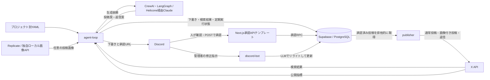

# 現状調査報告

調査日: 2026年10月7日（日本時間）  
対象: `C:\project\marketing-agent`、コミット `1fb0600`（初回実装を追加）

## 総合評価

X向けの投稿案生成、検索による見込み顧客候補の収集、返信案生成、人による承認、公開、指標収集までのバックエンドが実装されている。ただし、実装間の不整合と運用設定の不足があり、本番運用完了とは判断できない。現状は「主要機能の初期実装が揃い、結合検証と運用整備が残っている段階」である。

ここでの「実装済み」はコードの存在を意味し、外部サービスを含む動作確認済みを意味しない。調査では外部への投稿・通知、DB変更、サービス起動は行っていない。別ホストやWSL内の別チェックアウト、外部サービスの配置状態は未確認。

## システム構成

- 想定実行環境: Windows 11 Pro、WSL2 Ubuntu、Docker Desktop。READMEでは実運用のリポジトリをWSLのLinuxファイルシステムに置く方針。
- ランタイム: Python 3.12.12をDocker、CI、`.python-version`で指定。
- 常駐サービス: `agent-loop`、`publisher`、`discord-bot`。起動前検証の`preflight`を別途用意。
- ワークフロー: LangGraphで処理順を定義。投稿案・返信案はCrewAIの単一エージェントと単一タスクで生成。複数エージェントによる役割分担は実装されていない。
- LLM: 主経路はHelicone経由のClaude。コードの既定モデルは`claude-3-7-sonnet-20250219`。OpenAI用クライアント関数もあるが主要フローからの呼び出しは見当たらない。モデルの現在の提供状況やSDKとの互換性は今回未検証。
- X連携: Tweepy。通常投稿・検索・指標取得はv2クライアント、画像アップロードはv1 API。
- 永続化: SupabaseとDockerのメディアvolume。heartbeatはサービスごとに独立したvolume。
- Web側: Next.jsの承認APIテンプレートのみ。Next.jsアプリ一式や管理ダッシュボードはこのリポジトリにない。

## 機能構成と実装状況

| 機能 | コード上でできること | 残事項・制約 |
|---|---|---|
| 定期実行 | 検索・返信処理後に15分待機。宣伝案は6時間間隔、分析は12時間間隔をDBで管理 | LogEatsだけをコードに登録。時刻指定の予約投稿はない |
| 投稿案生成 | YAMLの役割・目的・対象層・話題を利用して生成し、UTM付きURLを付与 | URLは例示用。LLM接続と生成品質は未検証 |
| リスニング | 通常検索1件と課題検索3件を実行し、各最大10件を保存 | キーワード検索であり、自アカウント宛メンション専用の取得処理ではない。継続カーソル・ページングはない |
| 返信案生成 | 取得した投稿への返信案を最大5件ずつ生成し、承認待ちに保存 | DBとの項目名不整合があるため現状のままでは完了処理が失敗する |
| Discord通知 | 投稿本文・投稿ID・期限付き承認URL・任意の画像を通知 | 実Webhook接続は未検証 |
| 承認 | GETは確認画面、POSTで一回限りのトークンを消費して承認 | 別Next.jsアプリへの配置が必要。確認画面には投稿本文を表示しない |
| リライト | 許可guild・channel・roleに所属する管理者の返信で下書きを修正 | 専用の再承認通知やトークン再発行の接続がない。リライト保存時に品質ゲートを通していない |
| X公開 | 承認済み投稿をDBで確保して、約60秒ごとに最大10件送信 | 実アカウントでの投稿検証は未実施。送信開始後の成否不明は自動再送しない |
| 画像生成 | mock、Replicate、独自ローカルHTTP API。PNG/JPEG・寸法・容量を検証 | 既定は画像生成無効。ローカルAPIは指定JSON形式の実装が別途必要で、ComfyUIの標準APIとの直接接続ではない |
| 品質チェック | 空本文、文字数、ドメイン、タグ数、メンション、禁止語、同文の検査関数 | YAMLの設定名が不一致。同文検査に必要な過去投稿を各フローから渡していない |
| 分析 | 直近7日間の公開投稿の表示・いいね・リポスト・返信・ブックマークをDB更新 | レポート画面、CV計測、分析に基づく生成改善、自動学習はない |
| 運用基盤 | Docker、起動前検証、heartbeat、再試行、JSONログ、CI、バックアップ手順 | heartbeatの間隔不整合、ログ形式の混在、外部接続テスト不足がある |

設定の`persona`、`tone_of_voice`は定義されているが、生成プロンプトへ明示的に読み込む処理はない。`role`・`goal`・`backstory`は使用されている。複数プロジェクトを扱う構造はあるものの、現状はLogEatsの設定1件と共通のX認証情報で動く。

## データ構成

| テーブル | 保存する内容 |
|---|---|
| `posts_log` | 投稿本文、プロジェクト、画像パス、返信先、公開状態、X投稿ID、公開指標、公開処理の所有トークン |
| `mentions_log` | 検索で検出した投稿、投稿者、返信処理状態、処理所有トークン、試行回数 |
| `post_approval_tokens` | 承認トークンのハッシュ、有効期限、使用・失効情報 |
| `scheduled_job_runs` | プロジェクト・ジョブ単位の最終成功時刻、実行状態、処理所有トークン |
| `operations_audit_log` | failed投稿の復旧操作と運用メモ |

投稿の基本状態遷移は`draft → approved → publishing → published`。公開失敗は`failed`で停止し、送信開始前の一定条件を満たす投稿だけを復旧RPCで下書きへ戻す。SQLにはRLS、service role向けRPC権限、状態遷移制約、同時処理の排他制御が含まれる。これらの実DB上での適用・権限検証は未実施。

## 優先度の高い不整合・未完了事項

### 1. 返信処理のDB契約不一致

`supabase_migration.sql`の`claim_mentions_for_reply`は`processing_lease_token`を含むDB行を返す。一方、`src/reply_workflow.py`は`reply_lease_token`を参照する。Python側に項目名の変換はない。

このため成功時の完了更新も、品質エラー時・例外時の失敗更新も`KeyError`となる。下書き保存・通知後に失敗した場合、処理期限切れによる再確保で同じ対象の下書きや通知が重複する可能性がある。テストのモックがPython側の名前でデータを作っており、このSQLとの違いを検出できていない。

### 2. 必須Helicone設定が導入手順から欠落

`src/llm_client.py`は`HELICONE_API_KEY`を必須とするが、`.env.example`と`preflight`の必須一覧にない。用意された例に従って設定すると起動前検証を通過してもLLM生成に失敗し得る。Dopplerを前提とするコード内説明と、`.env`を使う現在の運用手順にもずれがある。

### 3. 品質ポリシーが読み込まれない

`projects/logeats.yaml`は`quality_gate`、投稿生成・返信生成・公開処理は`quality_policy`を読む。基本の既定値チェックは動くが、YAMLで指定した許可ドメイン等は適用されない。文字数はURLを23文字に置き換えた後のPythonの文字数で概算している。

### 4. 稼働監視が通常の待機を異常判定する

`agent-loop`はサイクル開始時だけheartbeatを更新し、その後15分待機する。一方、Composeの鮮度判定は120秒。通常運転でも待機中にunhealthyとなる構成。長時間の画像生成・LLM処理中も更新されない。

### 5. リライト後の承認が古い通知に紐づいたまま

リライトは本文の更新のみで、承認トークンの失効・再発行や本文バージョンとの紐づけがない。古い通知の承認URLが修正後の本文を承認する。承認APIのGET画面にも最新本文は表示されないため、承認対象の明示を整える必要がある。

### 6. 失敗・再試行・通知復旧に残る不足

- `fail_mention_reply`は`unprocessed`に戻すが、試行5回到達時に即座に`failed`へ変えない。次回claimは`retry_count < 5`だけを対象とするため、上限到達した`unprocessed`が処理されず残る経路がある。
- 下書き保存とDiscord通知は一体のトランザクションではなく、通知専用の再送待ちキューもない。通知に失敗して保存済みの下書きが残る可能性がある。
- 画像HTTP処理では`raise_for_status()`が`retry_call`の外にあり、HTTP 429/5xxに対する共通再試行が適用されない箇所がある。
- `REPLY_PROCESS_LIMIT`は設定読込のみで、通常サイクルから返信処理に渡していない。
- JSONログとマスキングはDiscord周辺で使われるが、主要ループは`print`中心。全ログがJSON・マスキング対象という運用説明とは一致しない。

### 7. 導入・結合検証は別途必要

承認テンプレートを稼働するNext.jsアプリへ組み込み、Supabase migration、Discord権限、X認証、実URL、LLM・画像サービス設定を揃える必要がある。承認API用の`NEXT_PUBLIC_SUPABASE_URL`もバックエンドの`SUPABASE_URL`とは別に設定する。依存関係の固定とCI定義はあるが、この調査でCI成功・Dockerビルド成功は確認していない。

## 今回の検証結果

- 調査開始時のGit作業ツリーに追跡対象ファイルの変更なし。履歴は初回実装の1コミットのみで、開発途中の作業順序や外部のタスク進捗は判定できない。
- Windows側のPythonは3.12.10。想定の3.12.12とパッチバージョンが異なる。
- `python -m compileall -q src scripts`は成功。
- `python -m unittest discover -s tests -v`は失敗。`crewai`、`supabase`、`discord`、`requests`等の依存不足により、関連テストの読み込み・実行ができない。SQL文字列検査、運用ファイル、heartbeat等の一部テストは成功。全機能のテスト成功とはいえない。
- Docker CLIは存在するが、`docker ps`はDocker DesktopのLinuxエンジンへ接続できず失敗。コンテナの稼働状態は取得できない。
- WSLの一覧にUbuntuとdocker-desktopが存在する。WSL内の別リポジトリやサービス状態は調査対象外。
- 外部API、実Supabase、実X投稿、実Discord通知、承認Webアプリの稼働は未確認。

既存テストには外部処理をモックへ置き換えたものや、SQL・TypeScriptの文字列を確認するものがある。実DBのRPC、実際のHTTP承認、外部APIまでの一連の動作を保証するテストではない。

## 次に進める順序

1. 返信処理の項目名、Helicone必須設定、品質設定名、heartbeat間隔の不整合を修正する。
2. 承認対象の本文確認とリライト後の再承認、通知失敗・返信試行上限の扱いを整える。
3. 想定Python・依存関係をWSL/Dockerに用意し、全テストとDockerビルドを確認する。
4. 検証用Supabaseと承認Webアプリを配置し、実DBのRPC・権限・同時処理を確認する。
5. テスト用X・Discordで生成、修正、承認、画像付き公開、返信、指標取得を一通り検証する。
6. その後、分析レポート、CV計測、生成改善、複数アカウントなど必要な追加機能を検討する。

調査のためにアプリケーションコードや設定は変更していない。この報告書のみ追加した。
