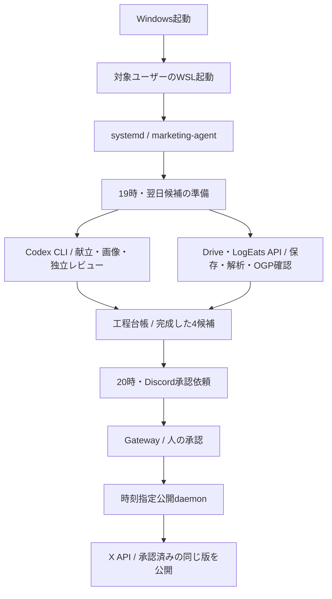

# サブPCのみな運用構成・CLI前提

改訂日: 2026年10月7日（JST）

## 採用する構成

Windows 11 Pro上のWSLで、Pythonオーケストレーターをsystemdから無人実行する。AI工程にはCodex CLIの非対話実行を使用する。ChatGPTデスクトップアプリは開発・調査用であり、日次運用・スケジュール・復旧に必須としない。

オーケストレーターが入力・工程順・状態・時刻・副作用を管理し、CLIを工程ごとに呼ぶ。まずChatGPT認証によるPro枠を使い、画像などの実地検証で必要と判明した工程だけOpenAIまたはGemini APIへの切替を検討する。

## 役割と境界

| 要素 | 担当すること | 認証・実行 |
|---|---|---|
| Pythonオーケストレーター | 工程順、品質ゲート、排他制御、再開、期限、失敗通知 | 専用Linuxユーザー、systemd |
| Codex CLI | 献立・一言生成、画像生成、実画像と解析値の独立レビュー | codex exec、ChatGPT認証、構造化出力 |
| Driveクライアント | 専用領域への保存、名前・容量・内容の再読取 | サーバー用の限定Google認証 |
| LogEatsクライアント | 未来日付3食登録、訂正、日次共有 | みな専用APIトークン |
| 通知daemon | 完成候補を20:00以降に通知 | Discord Bot |
| Gatewayサービス | 承認・差戻し・見送り、許可リスト・nonce・版の検証 | Discord Bot、外向き接続 |
| 公開daemon | 07:30・12:15・19:15・21:30 JSTの承認済み公開 | X API、AIを呼ばずに処理 |
| 監視・復旧処理 | 工程停止、認証失効、利用枠不足、再起動後の状態照合 | heartbeatと状態台帳 |

CLIへDiscord、X、Drive、LogEatsの秘密値を渡さない。CLIの出力は生成物とレビュー判定に限定し、外部サービスへの業務書き込みはPythonが行う。CLIに自由なツール操作で投稿を公開させない。

## 実行環境

- 開発用コード: `/home/logeats-runner-win/projects/marketing-agent`。
- 固定版のサービスコード: `/opt/marketing-agent`。
- 台帳、成果物、工程別の永続作業領域: `/var/lib/mina-agent`。
- 運用設定と限定Dopplerトークン: `/etc/marketing-agent`。
- 本番CLIの専用認証領域: `/var/lib/mina-agent/.codex`。
- 専用CLIの固定版配置: `/opt/marketing-agent/.codex-cli`（0.160.1）。

本番CLIは専用ユーザーのHOME・CODEX_HOME・実行ファイルパスを明示する。SSH開発ユーザーのログイン成功だけでは、本番ユーザーの無人実行に成功したと扱わない。専用ユーザーでもChatGPT認証、認証更新、組み込み画像生成を確認する。APIキー認証を暗黙に選択させない。

既存GitHub Actionsランナー2件は維持し、ランナーの作業領域や登録情報を使わない。

## AI工程

1. 履歴・対象JST日付・曜日・運用仕様を渡し、3食と4つの一言をJSONで生成する。
2. 食事ごとに画像を新規生成し、固定セット・食品・分量・品数を別呼び出しで点検する。
3. PythonがDriveへ保存・再読取し、LogEatsへ登録する。
4. 画像とLogEatsが返した食品・量・カロリー・PFCを、生成時の会話とは独立したCLI呼び出しでレビューする。
5. 個別共有3件と日次共有1件について、OGPのメタ項目に加えて実画像・表示値と元画像・解析値の対応を確認する。
6. Pythonが固定文・文字数・時刻・履歴・既存予約・画像の版を照合し、合格した4件を承認対象へ保存する。

CLIには`--output-schema`を指定し、最終JSONを受け取る。未確認事項の合格自己申告や、画像を入力していない画像レビューは採用しない。API固定文と解析数値をモデルへ書き換えさせない。

画像事前確認は、ユーザーが選択した「AI点検後に登録、20時に完成投稿候補を人が承認」を採用する。

## スケジュールと期限

- 19:00 JSTを初期値として翌日準備を起動する。画像生成・レビューを実測し、20時に間に合う開始時刻へ調整する。
- 20:00 JSTに完成した4投稿の承認依頼を送る。未完了なら理由を通知し、未完成を完成扱いしない。
- 承認後、翌日の4時刻に公開daemonが処理する。未承認・差戻し・見送りは公開しない。
- 再起動後に取りこぼした準備は台帳と実行可能な時間窓を検査する。タイマーの追実行だけで対象日を決めない。
- 投稿時刻を大きく過ぎた処理は後追い公開しない。現在の公開猶予は120秒。

アプリのスケジュール、メインPC、RDP接続、ブラウザーの起動状態へ依存しない。

## 状態と復旧

対象日・枠・工程名・入力ハッシュを台帳へ記録する。外部処理の開始を先に確定し、正常終了時に結果を保存する。

- 完了した工程は保存した結果と実体を再検証して利用する。
- 入力が変わった場合は、既存の外部状態を照合してから新しい版に進む。
- 開始後に停止した処理、LogEats登録のタイムアウト、X送信の成否不明は自動再実行しない。
- CLIが期限を超えた場合はプロセス群を終了し、作業領域・成果物・工程記録を保全する。終了直後に証跡を削除しない。
- CLIの長時間処理で承認受付や指定時刻公開を止めないよう、準備と公開のプロセスを分ける。
- 台帳のバックアップ、送信不明の照合と復旧操作、監視通知を本番開始条件とする。

現在のCodexClientは試作。プロセス群の終了と作業領域の保全は実装・テスト済み。運用ルールの入力、専用ユーザーの認証、サービスへの配置と工程間の連携は本番用に整備する必要がある。

## CLIとAPIの選び方

| 工程 | 第一候補 | APIを採用する判断材料 |
|---|---|---|
| 献立・コメント | Codex CLI | 利用枠、所要時間、構造化出力の安定性 |
| 画像生成 | CLIの組み込みimagegen | 無人実行、保存先制御、固定セットの再現性、20時までの所要時間 |
| 独立レビュー | CLIの画像入力 | レビュー品質、利用枠、所要時間 |

画像生成にAPIが必要なら、OpenAI画像APIとGemini画像APIを同じ献立・撮影スタイルで比較する。画質、LogEatsの認識品質、量と品数、修正回数、時間、3画像とレビューを含む日次費用で評価する。

APIは必要な工程だけに限定する。利用前にプロジェクト・資格情報・月額上限を決める。LogEats本体と同じプロバイダーは利用できるが、みな用のキー・計測・予算を分け、既存キーを黙って流用しない。

利用枠不足・HTTP 429・認証失効を、無制限なAPIへの自動切り替えで解消しない。将来限定した代替を設定する場合も、対象工程・最大回数・利用上限を明示する。

## Windows再起動後の無人復帰

systemdはWSLが起動してから動く。Windows起動時に、ディストリビューションを所有するWindowsユーザーの文脈でLogEats-Runnerを起動する経路が必要。

Windows起動タスクはSSHユーザーのCIM権限で未確認。所有者とログオン前の起動可否を確認し、必要な起動タスクを整備する。WSLはユーザーに紐づくためSYSTEMで起動できると仮定しない。Windowsを再起動し、RDPでログインしなくても各サービスが復帰することを検証する。

AC電源時の自動スリープは無効を確認済み。Linuxサービスの有効化だけを、Windows再起動後の無人復帰の証拠にしない。

## 実装・検証の順序

1. サブPCの実際のcodex execで、構造化献立、画像1枚、保存、画像レビューを確認する。この初回検証は完了した。
2. 献立・画像・独立レビューはCLIを採用する。連続運用で品質・利用枠・所要時間が不足した場合に、該当工程のOpenAI/Gemini APIを比較する。
3. 専用実行ユーザー、永続作業領域、認証更新、排他制御、期限・回数制限を整備する。
4. Drive・LogEats・Xを接続する。履歴取得と登録成否照会の不足も解消する。
5. 1日分の画像・解析・OGP・候補を作り、Discordの実承認を検証する。
6. X本アカウントと既存予約の衝突を確認し、承認済み投稿の時刻指定公開を検証する。
7. 準備タイマーを有効化し、連続運用・再起動・利用制限・成否不明からの復旧を確認する。
8. 新運用開始時に、旧「AI広報みな 週次効果測定・次週予約」を停止または計測専用へ変更して二重運用を防ぐ。現在の旧設定は変更していない。

## 現状

SSH・WSL・開発コード・検証daemon・20時タイマー・Discord Gatewayは確認済み。Botと承認者の認証・所属・通知権限も確認済み。

開発用LinuxユーザーのChatGPT認証で、CLIによる3食・4コメントの構造化生成、朝食画像1枚の生成・JPEG保存、別のCLI呼び出しによる画像点検の合格を確認した。CLI子プロセスにはOpenAI APIキーや外部サービスの秘密値を渡していない。

検証成果物はサブPC開発領域の`runtime/2026-10-08/`に保存した。生成された献立の食品数は10・16・13で、LogEatsの訂正上限20件に合わせて検証条件を修正し、同じ生成結果を再検証した。画像は373,471バイトのJPEG、独立点検結果は`image_acceptable`で理由コードなし。まだ食品登録・解析数値レビュー・OGP確認・人の承認を経た画像ではない。

専用テストはDriveクライアント・読取再開・CLI認証設定の診断を追加し、63件がメインPCとサブPCの開発環境で通過した。

専用サービスユーザー`mina-agent`のChatGPTデバイス認証は本人が完了し、ChatGPT認証方式を確認した。CLI関連モジュールとPillowをサービス配置先へ反映し、`NoNewPrivileges`・`ProtectSystem=strict`・`ProtectHome`・専用の書き込み領域を指定した一時systemdサービスで、実画像の独立レビューが実行できた。

このサービス側の初回レビューは`hold / context_mismatch`だった。保留原因を別呼び出しで具体化し、茶色のみそ汁椀など固定スタイルとの不一致を確認した。旧画像・判定は保存したまま、すべての器を白系陶器にする指示を強め、献立名を画像の別盛りと整合させた。

専用ユーザーと同じsystemd制限下で新規画像v2を生成し、独立レビューの`image_acceptable`・理由コードなしを確認した。JPEGは301,985バイト、生成・保存・レビューを含む一時サービスの実行時間は48.116秒。ChatGPT認証を使い、生成APIキーは渡していない。3画像・Drive・LogEatsを含む全工程の時間計測と日次サービスへの接続は未完了。1枚の生成成功は毎日の無人運用や20時の期限達成の証明ではない。

OpenAI APIで献立生成を1回試しHTTP 429となった。モデル一覧の認証成功は生成APIの利用成功を意味しない。429の詳細原因は未確定で、追加の生成API実行はしていない。

Vercelの本番・previewにLogEatsのみな専用トークンと対象アカウント設定が存在することを確認した。値は取得・変更していない。本人が既存トークンを新Dopplerへ登録し、サブPCで設定有無と32文字以上を確認した。API基点と共有ホストも設定した。実登録での認証・対象アカウント確認は未完了。

Driveはユーザー確認により既存と同じGoogleアカウントを使う。サーバー専用OAuthクライアント、保存と実体再読取を行うPythonクライアントを追加したが、実OAuth認証は未設定。X開発者App、履歴・成否照会、準備工程の連携、Windows再起動後の復帰も未完了。本番の通知・承認受付・X公開は停止中。

## 公式資料

- [非対話実行](https://learn.chatgpt.com/docs/non-interactive-mode): CLI、構造化出力、保存済み認証。
- [認証](https://learn.chatgpt.com/docs/auth): ChatGPT認証とAPIキー。
- [組み込み画像生成](https://learn.chatgpt.com/docs/image-generation): 利用枠と生成方式。
- [Gemini画像生成](https://ai.google.dev/gemini-api/docs/image-generation): API方式の比較候補。
